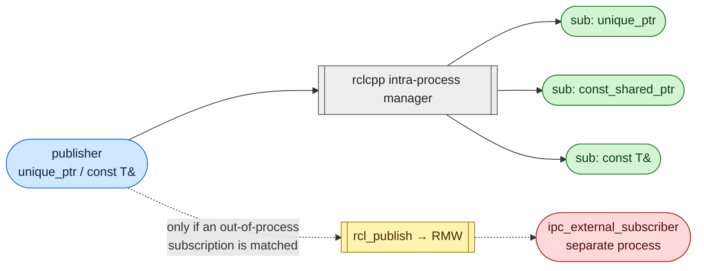

# ros2_intra-process_comms_test

Checks which rclcpp intra-process publish/subscribe combinations are really
zero-copy. Runs the 20 cases from
[Zero-copy intra-process communications with ROS 2](https://mshields.name/blog/2026-08-12-zero-copy-intra-process-communications-with-ros-2/)
for any supported message type and payload size, against any of several RMWs.

For every case the runner:

1. Creates one node with `use_intra_process_comms(true)`, the case's
   subscriptions (all in-process) and a publisher on a fresh topic, plus any
   out-of-process subscribers the case needs.
2. Publishes `warmup_iterations + iterations` frames, either by
   `publish(std::move(unique_ptr))` or `publish(const T &)`.
3. For every frame, opens an allocation window just before `publish()` and
   closes it once every subscription has had the frame and nothing else
   arrives.
4. Checks the address each subscription received against the one that was
   published, and counts what was allocated in the window.



## Quick start

```shell
# All 20 cases, PointCloud2 at the blog's 1.75 MiB, Cyclone DDS:
./run_single.sh

# Pick an RMW and pass any launch args after it:
./run_single.sh fastdds cases:=11,12,18
./run_single.sh zenoh message_type:=sensor_msgs/Image payload_bytes:=6220800
./run_single.sh cyclonedds message_type:=std_msgs/Float64

# Your own combination:
./run_single.sh cyclonedds cases:=custom \
    custom_publish:=unique_ptr \
    custom_subscriptions:=unique_ptr,const_ref \
    custom_external_subscribers:=1

# Matrix over RMW × message × payload:
./run_all.sh
MATRIX_RMWS="cyclonedds zenoh" \
MATRIX_MESSAGES="sensor_msgs/PointCloud2 sensor_msgs/Image std_msgs/Float64" \
MATRIX_PAYLOADS="1024 1840000 8388608" \
./run_all.sh
```

Each run prints a summary table and writes
`data/results/ipc_<rmw>_<msg>_<serialized_bytes>B_<ipc|noipc>_<ts>.csv`.
The CSV starts with a `#` metadata header: rmw, rclcpp version, distro,
payload sizes, host, CPU, OS and kernel.

## Knobs

Launch args for `ros2 launch ipc_zero_copy_tests ipc_cases.launch.py`, also
accepted after the service name by `run_single.sh`:

| launch arg                    | default                   | notes |
|-------------------------------|---------------------------|-------|
| `message_type`                | `sensor_msgs/PointCloud2` | any type in [Supported messages](#supported-messages); `list` prints them |
| `payload_bytes`               | `1840000`                 | target size of the variable-length field. The default is 115k × 16-byte points, as in the blog. Fixed-size types ignore it |
| `cases`                       | `all`                     | `all`, a comma list of ids (`11,12,18`), or `custom` |
| `custom_publish`              | `unique_ptr`              | `unique_ptr` or `const_ref` (the blog's "by value") |
| `custom_subscriptions`        | `unique_ptr`              | comma list of `unique_ptr`, `shared_ptr`, `const_shared_ptr`, `const_shared_ptr_ref`, `const_ref` |
| `custom_external_subscribers` | `0`                       | out-of-process subscribers for the custom case |
| `iterations`                  | `100`                     | measured frames per case |
| `warmup_iterations`           | `10`                      | unmeasured frames per case before measuring |
| `use_intra_process_comms`     | `true`                    | with `false`, verdicts are `n/a` |
| `qos_depth`                   | `10`                      | KeepLast depth (reliable, volatile) |
| `settle_ms`                   | `2.0`                     | after a frame reaches every subscription, keep spinning until nothing new arrives for this long |
| `output_dir`                  | `/data/results`           | inside the container (mounted from `./data`) |

`run_all.sh` axes, each a space-separated list that can be set from the
environment: `MATRIX_RMWS` (default `cyclonedds fastdds zenoh`),
`MATRIX_MESSAGES`, `MATRIX_PAYLOADS`. Single values: `MATRIX_CASES`,
`MATRIX_ITERATIONS`, `MATRIX_IPC`. Fixed-size types run once instead of once
per payload.

## Cases

Numbered as in the blog. "Copies" means in-process subscriptions that receive
a buffer other than the published one. "Payload allocs" means
payload-sized allocations per frame on the publishing thread.

| #  | publish    | in-process subscriptions                         | out-of-process | copies | payload allocs |
|----|------------|--------------------------------------------------|----------------|--------|----------------|
| 1  | unique_ptr | UniquePtr                                        | –              | 0 | 0 |
| 2  | unique_ptr | ConstSharedPtr                                   | –              | 0 | 0 |
| 3  | unique_ptr | SharedPtr (mutable, deprecated)                  | –              | 0 | 0 |
| 4  | by value   | UniquePtr                                        | –              | 1 | 1 |
| 5  | by value   | ConstSharedPtr                                   | –              | 1 | 1 |
| 6  | unique_ptr | 2× UniquePtr                                     | –              | 1 | 1 |
| 7  | unique_ptr | 3× ConstSharedPtr                                | –              | 0 | 0 |
| 8  | unique_ptr | UniquePtr + ConstSharedPtr                       | –              | 1 | 1 |
| 9  | unique_ptr | UniquePtr + 2× ConstSharedPtr                    | –              | 2 | 1 (shared group shares one copy) |
| 10 | unique_ptr | 2× SharedPtr (mutable)                           | –              | 1 | 1 |
| 11 | unique_ptr | UniquePtr                                        | 1              | 0 | RMW-dependent, one more than 12/18 |
| 12 | unique_ptr | ConstSharedPtr                                   | 1              | 0 | RMW-dependent |
| 13 | unique_ptr | const T&                                         | –              | 0 | 0 |
| 14 | unique_ptr | 3× const T&                                      | –              | 0 | 0 |
| 15 | unique_ptr | const T& + ConstSharedPtr                        | –              | 0 | 0 |
| 16 | by value   | const T&                                         | –              | 1 | 1 |
| 17 | unique_ptr | const T& + UniquePtr                             | –              | 1 | 1 |
| 18 | unique_ptr | const T&                                         | 1              | 0 | RMW-dependent |
| 19 | unique_ptr | const ConstSharedPtr&                            | –              | 0 | 0 |
| 20 | unique_ptr | const T& + ConstSharedPtr + const ConstSharedPtr& | –             | 0 | 0 |

### Why 11 costs one more payload than 12 and 18

When an out-of-process subscription is matched, `Publisher::publish(unique_ptr)`
calls `IntraProcessManager::do_intra_process_publish_and_return_shared()` and
then publishes the returned `shared_ptr` through `rcl_publish()`.

- With no take-ownership subscription (12, 18), the `unique_ptr` is converted
  to a `shared_ptr` without copying.
- With one (11), the original goes to the owning subscription and a copy is
  made with `std::allocate_shared` for the inter-process publish.

This copy is made in rclcpp, not rcl, and is expected with the current design.
`rmw_publish` is synchronous for non-loaned messages, so publishing
inter-process first and then moving the `unique_ptr` to a single owning
subscription would avoid it. That is a possible optimisation, not a fix for a
correctness bug.

## Reading the output

```
case publish    subscriptions        ext copies    payload allocs MiB/frame    MiB/frame    verdict
                (per-sub result)         exp/obs   exp/obs        (thread)     (all thr.)
8    unique_ptr unique_ptr=same;const_shared_ptr=copy  0   1/1       1/1            1.76         1.76         PASS
```

- **per-sub result**: what each subscription received:
  - `same`: the published buffer.
  - `copy`: a deep copy.
  - `mixed(n/N)`: a copy in only some frames.
  - `+dup(n)`: n extra deliveries beyond one per frame.
- **copies / payload allocs**: expected from the blog vs. observed. `rmw` means
  no fixed expectation, because the RMW's serialization allocates too. `n/a`
  means the payload buffer is under 4 KiB, too small to tell a copy apart from
  bookkeeping allocations.
- **per-frame columns**: median bytes allocated per frame, on the publishing
  thread and across all threads. The unit (B, KiB or MiB) follows the payload
  size.
- **verdict**:
  - `PASS`: matches the blog.
  - `DIFF`: copies or payload allocations differ.
  - `MIXED`: inconsistent across frames.
  - `DUP`: duplicate deliveries.
  - `ERROR`: discovery or delivery timed out.
  - `n/a`: custom case, or IPC disabled.

The CSV has one row per case with the same data, plus the min/max of bytes
per frame, allocation counts and the number of measured frames.

## How it's measured

- **Address check.** For types with a variable-length field the address
  compared is that field's heap buffer (`PointCloud2::data.data()`, as in the
  blog). Otherwise it is the message object's address. The allocator hook
  watches the published address. If it is freed and the allocator hands it
  out again for a copy, the delivery counts as a copy, not as zero-copy.
- **Allocation counting.** `ipc_case_runner` replaces the global
  `operator new`/`delete` family, so the hook applies to every library in the
  process. Only `operator new` is counted; direct `malloc()` from C code is
  not, which matches the blog. The message is built before the window opens,
  so only what rclcpp and the RMW allocate during `publish()` and dispatch is
  counted.
- **Duplicate detection.** After every subscription has the frame, the
  runner keeps calling `spin_some()` until nothing new arrives for
  `settle_ms`. The executor runs ready subscriptions before ready waitables,
  so stopping at the first delivery could leave an intra-process delivery
  stuck behind an RMW copy of the same frame.
- **Out-of-process subscribers.** `ipc_external_subscriber` holds a generic
  (serialized) subscription and is spawned per case with `posix_spawn`. The
  runner waits until `publisher->get_subscription_count()` includes it, so
  rclcpp takes the inter-process path.
- **Executor.** `SingleThreadedExecutor`, spun on the publishing thread.

## Example results

Docker image `ros:lyrical-ros-base`, rclcpp 32.0.3, `sensor_msgs/PointCloud2`
at 1,840,000 B, Intel Core Ultra 9 285H, Linux 7.0.0-42-generic. Cases 1–10
and 13–20 pass on all three RMWs. Results per frame for the out-of-process
cases:

| case | cyclonedds         | fastdds                   | zenoh              |
|------|--------------------|---------------------------|--------------------|
| 11   | PASS, 3 / 5.27 MiB | **DUP**, 3 / 5.27 MiB     | PASS, 2 / 3.51 MiB |
| 12   | PASS, 2 / 3.51 MiB | **DUP**, 1 / 1.76 MiB     | PASS, 1 / 1.76 MiB |
| 18   | PASS, 2 / 3.51 MiB | **DUP**, 1 / 1.76 MiB     | PASS, 1 / 1.76 MiB |

(payload allocs / MiB on the publishing thread)

- In every RMW, case 11 costs exactly one payload more than 12 and 18. That is
  the `allocate_shared` copy described above. The blog measured 7.02 MiB vs
  5.27 MiB on Cyclone: the absolute numbers differ by one payload, but the
  delta is the same.
- **Fast DDS delivers every frame twice to the in-process subscription** when
  an out-of-process subscriber is matched: once through intra-process (zero
  copy) and once as a deserialized RMW copy. rclcpp normally drops the RMW
  copy, because `Subscription::handle_message()` recognises the sample's
  `publisher_gid` as one of its intra-process publishers. On this setup
  `rmw_fastrtps_cpp` reports a `MessageInfo::publisher_gid` whose entity id is
  one higher than `Publisher::get_gid()` (`…0903` vs `…0803`), whether or not
  intra-process is enabled. So the check fails and the copy gets through.

## Supported messages

Types with a variable-length field, sized from `payload_bytes`:

| type | field sized | zero-copy check on |
|---|---|---|
| `sensor_msgs/PointCloud2` | `data` (x, y, z, intensity float32; 16-byte points) | `data.data()` |
| `sensor_msgs/Image` | `data` (mono8, one row) | `data.data()` |
| `sensor_msgs/LaserScan` | `ranges` | `ranges.data()` |
| `sensor_msgs/JointState` | `position` | `position.data()` |
| `sensor_msgs/PointCloud` | `points` | `points.data()` |
| `nav_msgs/Path` | `poses` | `poses.data()` |
| `std_msgs/String` | `data` | `data.data()` |
| `std_msgs/{Byte,Float32,Float64,Int8,Int16,Int32,Int64,UInt8,UInt16,UInt32,UInt64}MultiArray` | `data` | `data.data()` |

Fixed-size types are checked on the message object's address, and
`payload_bytes` is ignored:
`sensor_msgs/{Imu,Range,Temperature,FluidPressure}`,
`nav_msgs/Odometry`,
`geometry_msgs/{PointStamped,PoseStamped,TwistStamped,WrenchStamped,TransformStamped}`,
`std_msgs/{Header,Bool,Byte,Char,ColorRGBA,Empty,Float32,Float64,Int8,Int16,Int32,Int64,UInt8,UInt16,UInt32,UInt64,MultiArrayDimension,MultiArrayLayout}`.

To add a type, add one line to `SUPPORTED_TYPES` in
`src/ipc_zero_copy_tests/CMakeLists.txt`; its registration file is generated
from `src/register_type.cpp.in`. If the type has a variable-length field, also
add `fill_payload()` and `IPC_ZERO_COPY_PAYLOAD_FIELD(...)` to
`include/ipc_zero_copy_tests/payload_traits.hpp` and list the type in
`VARIABLE_SIZE_TYPES` in `run_all.sh`.

## Supported middlewares

| service | RMW |
|---|---|
| `cyclonedds` | `rmw_cyclonedds_cpp` |
| `fastdds` | `rmw_fastrtps_cpp` |
| `zenoh` | `rmw_zenoh_cpp` (router started in the container) |

The RMW only matters for cases with an out-of-process subscriber (11, 12, 18,
or a custom case). Every other case stays inside rclcpp's intra-process
manager. The ROS distro is a build arg (`ROS_DISTRO`, default `lyrical`) in
`docker/Dockerfile`.

## Layout

```
src/ipc_zero_copy_tests/
  include/ipc_zero_copy_tests/
    alloc_counter.hpp     allocation window + address-reuse watch
    cases.hpp             CaseSpec, publish/subscription kinds
    case_runner.hpp       run_case<MsgT>(), external subscriber spawner, type registry
    payload_traits.hpp    fill_payload() / payload_buffer() per type
  src/
    alloc_counter.cpp     global operator new/delete replacements
    cases.cpp             the 20 blog cases + parsing
    case_runner.cpp       registry, posix_spawn of external subscribers
    main.cpp              parameters, summary table, CSV
    external_subscriber.cpp
    register_type.cpp.in  per-type registration template
  launch/ipc_cases.launch.py
docker/                   Dockerfile, compose file, per-RMW install scripts
run_single.sh, run_all.sh
```

## License

MIT, see [LICENSE](LICENSE).
